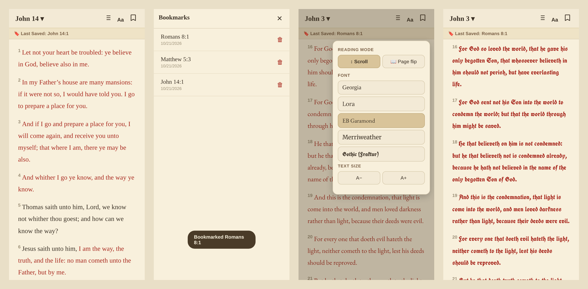
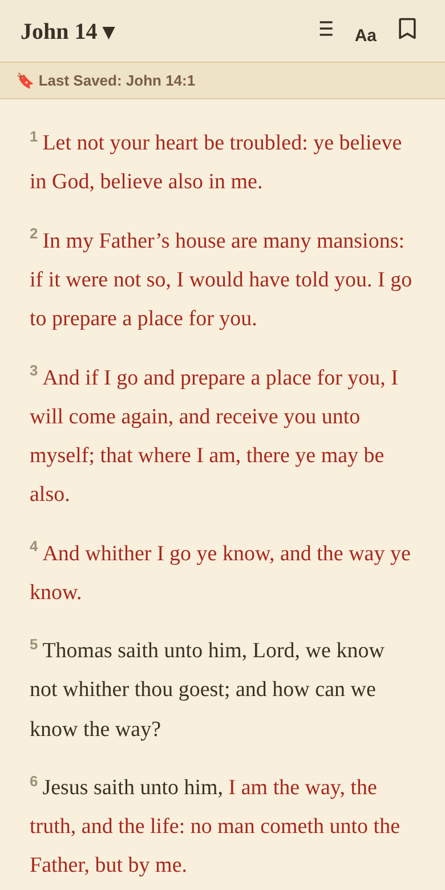
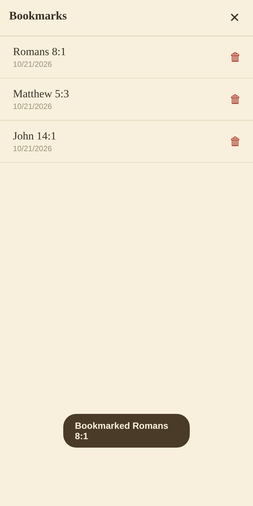
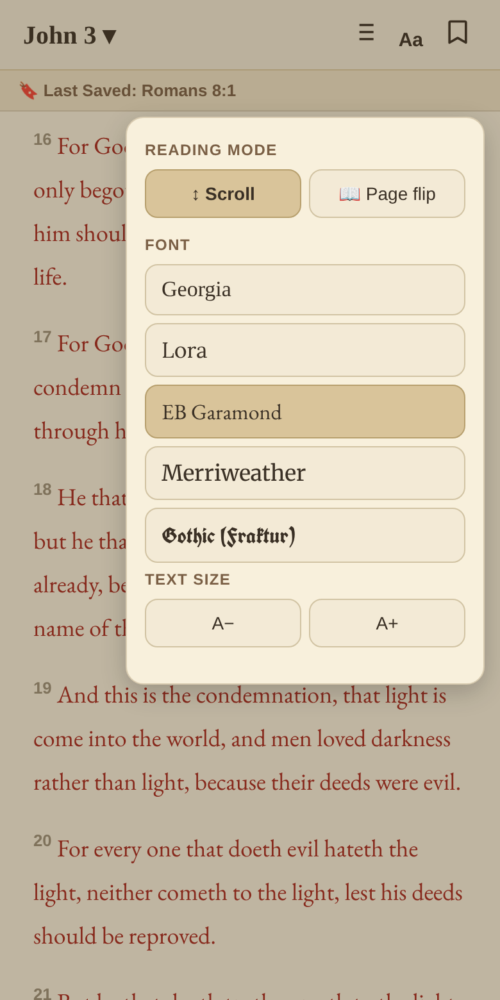
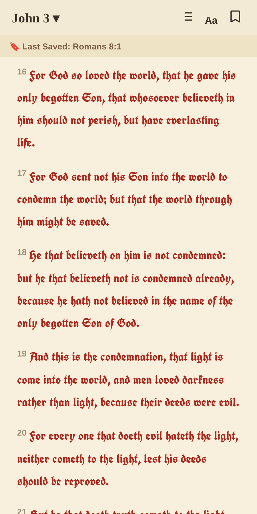
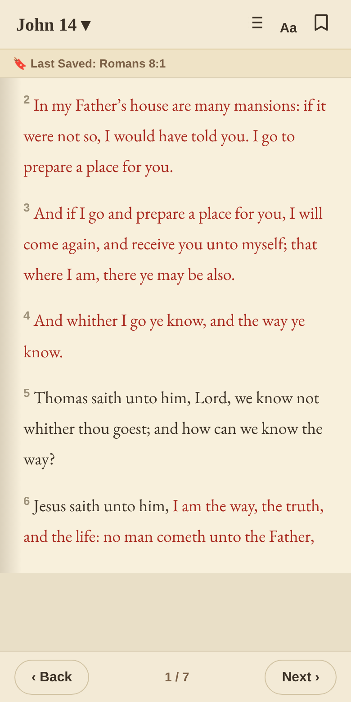

# 📖 New Testament (KJV) – Red-Letter Android App

A clean, offline King James New Testament reader for Android, with the **words of Jesus in red**.

## Features

- **Complete KJV New Testament** – 27 books, 260 chapters, 7,957 verses, verified against the official verse counts.
- **Red-letter text** – the words of Jesus are highlighted (curated in `data/jesus-words.txt`).
- **Bookmarks** – tap 🔖 to save your place; tap the list button in the top bar to **view, jump to, or delete** all saved bookmarks. A "Last Saved" shortcut is always shown under the title.
- **5 reading fonts** – Georgia, Lora, EB Garamond, Merriweather and a **Gothic (Fraktur)** blackletter face. Fonts are bundled, so everything works fully offline.
- **Two reading modes** – continuous scroll, or a realistic **page-flip** with curl animation.
- **Adjustable text size**, tap-to-highlight verses, and quick book/chapter picker.
- Remembers your place, font, size and mode between launches.

## Screenshots

| Reading | Bookmarks | Fonts | Gothic font |
|---|---|---|---|
|  |  |  |  |

Page-flip mode:

## Build the APK

1. Push this repo to GitHub.
2. Go to **Actions → "Build Android APK"** and run it.
3. Download the `new-testament-apk` artifact and install it.

## Project layout

| Path | Purpose |
|---|---|
| `www/index.html` | The whole app (HTML/CSS/JS) |
| `www/nt.json` | Verse data with red-letter markers |
| `www/fonts/` | Bundled web fonts (SIL OFL licensed: Lora, EB Garamond, Merriweather, UnifrakturCook) |
| `data/jesus-words.txt` | Hand-curated words of Jesus – edit, then run `python3 tools/build_red.py` |
| `tools/extract/` | Scripts that extracted the plain text from the source PDF |

Built with [Capacitor](https://capacitorjs.com/).
